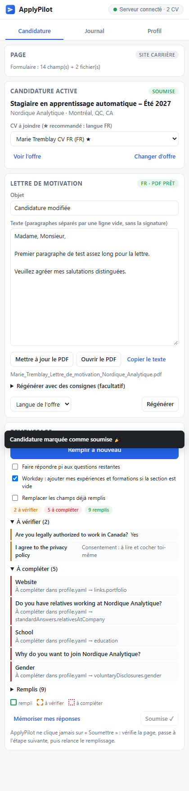
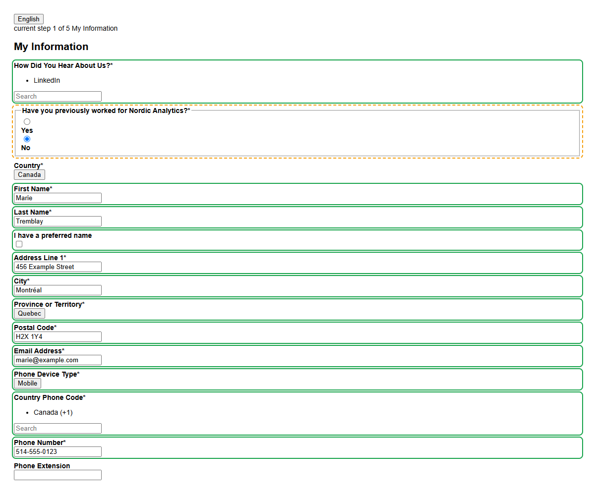
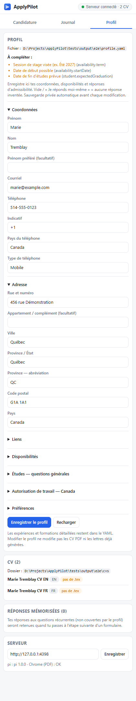

# ApplyPilot

**Postule plus vite à tes stages, sans retaper les mêmes infos.** ApplyPilot est une extension Chrome locale + un petit serveur sur ta machine :

- 📄 **Lettres de motivation sur mesure** : l'IA lit l'offre et ton CV (LaTeX), puis rédige une lettre dans la langue de l'offre, dans ton style. Elle produit un PDF propre d'une page, que tu peux retoucher.
- ✍️ **Remplissage automatique des formulaires** : Workday (pays, adresse, téléphone, « How did you hear about us? », expériences, formations, dates, questions oui/non, déclarations volontaires…), Greenhouse, Lever et la plupart des sites carrière maison.
- 📎 **Pièces jointes** : le bon CV (FR, EN ou variante spécialisée) et la lettre sont joints automatiquement.
- 🧠 **Questions ouvertes** : « Pourquoi nous ? » et les questions propres à chaque entreprise sont rédigées par l'IA, sans jamais inventer de faits.
- 🗂️ **Journal des candidatures** : statut, date, CV et lettre envoyés, avec export CSV.
- 🔁 **Mémoire** : tes réponses aux questions récurrentes sont retenues pour les candidatures suivantes.
- ⚙️ **Profil modifiable dans le panneau** : coordonnées, adresse, disponibilités et admissibilité, avec sauvegardes privées et protection contre les modifications concurrentes.
- 🔎 **Exigences de l’offre repérées dès l’analyse** : relevé de notes, stage crédité, GPA minimum, bilinguisme, présentiel, vérifications, rémunération, date limite. Chacune est comparée à ton profil (✓ prêt, ! à compléter).
- 🌐 **Langues et sites Web** : blocs Workday « Langues » (niveaux, « je parle couramment ») et « Sites Web » (GitHub, portfolio) ajoutés et remplis depuis ton profil.
- 📑 **Relevé de notes** : indique son chemin une fois dans **Profil → Documents**, il est joint aux champs « relevé de notes ».

> ApplyPilot **ne clique jamais sur « Soumettre »**. Il remplit, surligne ce qu'il faut vérifier, et c'est toi qui envoies.

<p align="center"> &nbsp; </p>

## Comment ça marche

```
 Chrome ──────────────────────────────┐        ┌───────────── ta machine ─────────────┐
 │ Page de l'offre / formulaire      │        │  Serveur ApplyPilot (127.0.0.1)     │
 │   ↑ remplit les champs            │  HTTP  │   • profile.yaml (tes infos)        │
 │ Panneau latéral ApplyPilot ───────┼───────►│   • dossier de CV (.pdf + .tex)     │
 │   analyser · lettre · remplir     │        │   • pi --print → lettres, réponses  │
 └───────────────────────────────────┘        │   • Chrome headless → PDF           │
                                               │   • data/ : candidatures, journal   │
                                               └─────────────────────────────────────┘
```

L'extension ne peut ni lire tes fichiers ni appeler l'IA. C'est le serveur local qui s'en charge :

- il lit ton profil et tes CV ;
- il appelle [pi](https://pi.dev) en mode non interactif (avec ta connexion existante, donc aucune clé API supplémentaire) ;
- il produit le PDF de la lettre avec Chrome ;
- il tient le journal de tes candidatures.

## Installation

Prérequis :

- **Node.js 20+** ;
- **Google Chrome** ou **Edge** ;
- **[pi](https://pi.dev)** installé et connecté à un fournisseur de modèle. Sinon, indique la commande dans `config.yaml → llm.command`.

1. **Récupère le projet**
   ```sh
   git clone https://github.com/Mbaka11/ApplyPilot.git
   ```
2. **Démarre le serveur** : double-clique sur `start.cmd` (Windows) ou lance `./start.sh` (macOS/Linux).
   - Au premier lancement, les dépendances s'installent automatiquement.
   - Les fichiers `config.yaml` et `profile.yaml` sont créés à partir des exemples.
   - Laisse la fenêtre ouverte pendant que tu postules.
3. **Configure** :
   - `config.yaml` : `cvDir` = le dossier de tes CV. Pour chaque `X.pdf`, ApplyPilot lit aussi `X/main.tex` ou `X.tex`. Décris tes variantes dans `cvs` (langue, mots-clés).
   - Onglet **Profil** de l’extension : modifie tes coordonnées, adresse, disponibilités et réponses d’admissibilité, puis clique sur **Enregistrer le profil**. Le prochain remplissage utilise ces informations.
   - `profile.yaml` reste accessible pour les expériences, formations détaillées et niveaux de langue. Les modifications manuelles sont prises en compte immédiatement.
   - Facultatif : place une ou deux de tes anciennes lettres en `.txt` dans `data/style/`, pour que l'IA imite ton style.
4. **Installe l'extension** :
   - va dans `chrome://extensions` ;
   - active le **Mode développeur** ;
   - clique sur **Charger l'extension non empaquetée** et choisis le dossier `extension/` ;
   - épingle l'icône ApplyPilot : un clic ouvre le panneau latéral.

### Mettre à jour sans perdre un formulaire ouvert

Pas besoin de supprimer ou de réimporter l’extension : dans `chrome://extensions`, clique sur **↻ Recharger** sur la carte ApplyPilot, puis ferme et rouvre son panneau sur l’onglet de candidature.

Clique ensuite sur **Remplir cette page**. Les nouveaux scripts sont réinjectés sur l’onglet déjà ouvert, sans naviguer ni recharger Workday. Laisse **Remplacer les champs déjà remplis** décoché. Évite F5 tant que tes saisies ne sont pas enregistrées.

## Utilisation

1. **Ouvre l'offre** (sur Workday, LinkedIn → site de l'entreprise, etc.) puis clique sur **Analyser cette offre**. La candidature devient *active* et reste active pendant que tu passes d'une page à l'autre du formulaire. Le CV le plus adapté est présélectionné (★).
2. **Génère la lettre**. Compte 20 à 60 s. Relis-la, corrige-la dans le panneau, puis clique sur **Mettre à jour le PDF**. Les avertissements listent ce que l'IA n'a pas pu confirmer (disponibilités, niveau de langue…).
3. **Clique « Postuler / connexion » dans le panneau** (ou « Postuler » sur le site), puis **Remplir cette page** à chaque étape :
   - 🟩 **vert** : rempli depuis ton profil ;
   - 🟧 **orange** : à vérifier (réponses oui/non d'admissibilité, réponses de l'IA, cases de consentement à cocher toi-même) ;
   - 🟥 **rouge** : à compléter (info absente du profil : renseigne-la dans l’onglet **Profil**, ou dans `profile.yaml` pour les champs détaillés).

   Clique sur un élément de la liste pour aller au champ concerné.
4. **Vérifie, passe à l'étape suivante**, relance le remplissage, puis **soumets toi-même sur le site de l’employeur**. Seulement après sa confirmation, clique sur **J'ai soumis ✓** : ce bouton ne fait que marquer le journal, il n’envoie rien. Un marquage erroné peut être annulé dans **Journal → En cours** (la fausse date de soumission est retirée).
5. Suis tes candidatures dans l'onglet **Journal** (statuts : soumise, entrevue, refusée, offre…), avec un export CSV. Le fichier `data/candidatures.csv` est aussi tenu à jour.

### Astuces Workday

- **Autofill with Resume** : ApplyPilot joint ton CV, Workday le lit, puis ApplyPilot complète et corrige le reste.
- **Apply Manually** : ApplyPilot ajoute lui-même tes blocs *Expérience* et *Formation* si les sections sont vides (option du panneau).
- Un compte par entreprise reste généralement nécessaire : un compte chez CAE ne donne pas accès au portail d’une autre entreprise.
- **Postuler / connexion** ouvre le formulaire dans le navigateur où l’extension est installée. Une session Workday encore valide est réutilisée par Chrome. Un formulaire déjà ouvert est activé sans être rechargé, pour conserver tes saisies.
- Sur une page de connexion, **Remplir cette page** renseigne le courriel uniquement. Laisse le gestionnaire de mots de passe de Chrome fournir le mot de passe, puis connecte-toi toi-même. Sessions expirées, CAPTCHA, double authentification et création de compte restent manuels. Aucun mot de passe n’est stocké par ApplyPilot.

### Pourquoi la 0.3.0 remplit mieux Workday

Quand tu cliques dans le panneau latéral, la page n’a plus le focus clavier. Chrome met alors bien à jour les valeurs, mais n’émet **aucun** événement `focus` ou `blur`. Or Workday n’enregistre un champ qu’à sa sortie : il affichait la valeur, puis répondait « The field … is required ».

ApplyPilot émule désormais ces événements, y compris quand Workday déplace le focus lui-même, par exemple vers une liste ouverte. Les tests rejouent ce cas avec une page en arrière-plan.

### Compétences Workday (correctif 0.3.1)

La recherche clique sur la feuille sélectionnable de chaque résultat, plutôt que sur le wrapper qui ne fait que le surligner. Elle relit les contrôles recréés par Workday et vérifie les **pastilles réellement sélectionnées**, y compris quand la liste est repliée. Ni une requête tapée, ni un résultat surligné, ni une annonce ARIA ne sont comptés comme une compétence ajoutée.

Les compétences déjà choisies sont conservées et celles qui manquent sont ajoutées sans doublons, même avec l’écrasement désactivé. Les options non sélectionnées restent signalées à compléter ; elles ne sont pas remplacées par des réponses inventées par l’IA.

Les champs **Location** des expériences viennent de `experience[].location`, indépendamment de `identity.address.city` (ville de résidence). Un lieu vide dans le profil reste à compléter : ne pas le déduire de l’adresse personnelle.

### Mémoire des réponses

Les questions que ton profil ne couvre pas, par exemple « Do you have a valid driver's license? », sont retenues quand tu cliques sur *Suivant* (ou *Mémoriser mes réponses*). Elles sont réutilisées automatiquement la fois suivante. Tu peux les gérer dans l'onglet **Profil**.

### Éditer le profil

L’onglet **Profil** enregistre uniquement les champs que tu as modifiés, dans `profile.yaml`. Avant chaque sauvegarde, une copie privée est conservée dans `data/backups/profile/`. Si le fichier a changé ailleurs, l’application refuse de l’écraser et conserve tes saisies : utilise **Recharger** pour repartir de la version du fichier.

L’éditeur couvre aussi le **stage crédité**, les **niveaux de langue** (natif, courant, avancé, intermédiaire, notions) et le **chemin du relevé de notes**. Pour ce dernier, tu peux coller le chemin obtenu avec « Copier en tant que chemin » dans l’Explorateur Windows.

**Vide / « Je réponds moi-même »** laisse une information inconnue sans l’inventer. Modifier le profil ne modifie pas automatiquement les CV PDF ni les lettres déjà générées : garde les dates des études cohérentes et utilise **Mettre à jour le PDF** pour une lettre existante.

<details><summary>Aperçu de l’éditeur (profil fictif)</summary></details>

## Confidentialité et sécurité

- Tout reste **sur ta machine** : le serveur écoute uniquement `127.0.0.1` et refuse les requêtes venant de sites web (contrôle des en-têtes `Origin` et `Host`).
- `profile.yaml`, `config.yaml` et `data/` (lettres, journal, mémoire) sont **exclus de git**.
- Pour rédiger, l'offre, ton CV et ton profil sont envoyés au modèle configuré dans pi (ton fournisseur habituel). Rien d'autre ne quitte ta machine.
- Les mots de passe, CAPTCHA, signatures et cases de consentement ne sont **jamais** remplis.

## Limites

- Aucune soumission automatique, et c'est voulu : une mauvaise réponse envoyée peut couler une candidature.
- Chaque site a ses particularités. Les composants inhabituels (calendriers, listes exotiques) peuvent rester en rouge : complète-les à la main.
- Les réponses générées par l'IA sont toujours marquées « à vérifier ».

## Configuration (extrait)

| Clé | Rôle |
|---|---|
| `cvDir`, `cvs[]` | Dossier des CV ; langue, libellé et mots-clés de chaque variante |
| `llm.model`, `llm.letterThinking` | Modèle pi (vide = modèle par défaut) et niveau de réflexion |
| `letter.paper`, `letter.showHeader` | Format (Letter/A4) et en-tête nom + coordonnées |
| `letter.fileNameFr` / `fileNameEn` | Nom du PDF, ex. `{first}_{last}_Lettre_de_motivation_{company}.pdf` |
| `fill.attachLetterWithCv` | Joint aussi la lettre dans le champ CV s'il accepte plusieurs fichiers |
| `fill.cvFileName` | Nom du CV envoyé (`{first}_{last}_CV.pdf` par défaut) : le nom d’une variante ciblée n’est jamais exposé |

## Dépannage

| Problème | Solution |
|---|---|
| « Serveur arrêté » dans le panneau | Lance `start.cmd`, puis clique sur le badge pour revérifier |
| Rien ne se passe après une mise à jour | Recharge l’extension dans `chrome://extensions`, ferme/rouvre le panneau et relance le remplissage ; pas de F5 sur un formulaire non enregistré |
| Workday : « The field City is required » alors que la valeur est affichée | Corrigé en 0.3.0. Recharge l’extension dans `chrome://extensions`, puis relance **Remplir cette page** |
| Workday : recherche tapée mais compétences non sélectionnées | Mets à jour en 0.3.1, recharge l’extension puis relance le remplissage : seules les pastilles vérifiées comptent, les choix existants sont gardés |
| Pas de formulaire dans l’onglet Profil | Redémarre le serveur, puis recharge l’extension dans `chrome://extensions` |
| Connexion Workday redemandée | Vérifie que tu utilises le bon profil Chrome et le bon portail entreprise ; la session peut avoir expiré |
| « Impossible d'écrire … .pdf » | Ferme le PDF s'il est ouvert dans Acrobat ou un autre lecteur |
| Erreur pi | Lance `pi` une fois dans un terminal pour vérifier la connexion (`/login`) |
| Accents bizarres dans Excel | Le CSV utilise `;` et l'UTF-8 avec BOM. Ouvre-le avec *Données → À partir d'un fichier texte* si besoin |

## Tests

```sh
cd server
npm test                 # serveur + scripts de contenu + extension complète (Chrome headless)
set APPLYPILOT_TEST_LLM=1 && npm run test:server   # + vraie génération via pi (Windows)
```

Les tests utilisent des pages qui imitent Workday et un formulaire générique, ainsi qu'un profil fictif. Ils rejouent le focus du panneau, les feuilles sélectionnables imbriquées, les options différées, les contrôles recréés, les pastilles repliées et la réinjection sans rechargement de page. Ils n'utilisent jamais tes données et ne remplacent pas la validation sur le formulaire réel d’un employeur.

## Structure

```
extension/        Extension Chrome (MV3) : panneau latéral + scripts de contenu
  content/        dom · extract (offre) · fields (inventaire) · widgets · mapping (règles) · workday · main
  sidepanel/      interface du panneau
server/src/       Serveur local : config, CV, pi, lettre → PDF, journal, mémoire
tests/            Tests (serveur, contenu, bout en bout) et pages de test
config.example.yaml, profile.example.yaml
```
