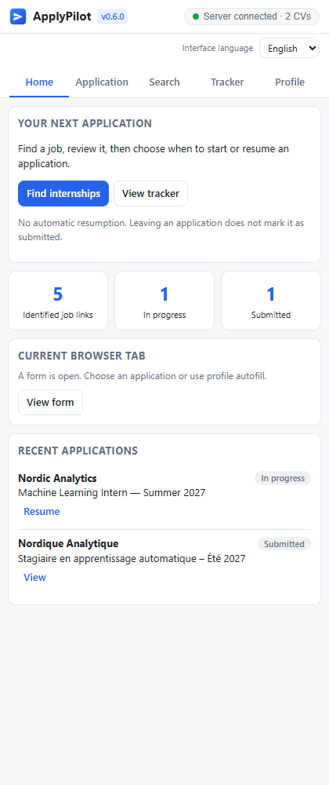
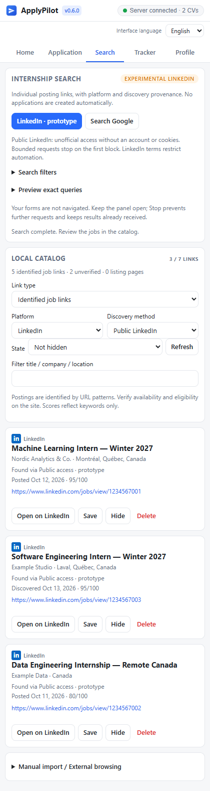
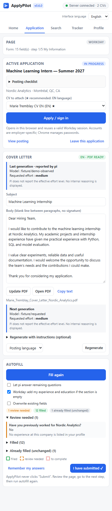

# ApplyPilot

[](https://github.com/Mbaka11/ApplyPilot/releases/latest)


> **LinkedIn integration is experimental.** Its public surface returned 200 during an initial probe, then 429 during connector validation. It is **not a reliable or officially supported integration**. Version 0.6.0 includes the bounded connector with these limitations, not a claim of production readiness. See the [investigation and verification notes](docs/prototype.md).

**Apply to internships faster, without typing the same information again.** ApplyPilot pairs a Chrome side panel with a small local Node.js server:

- 🏠 **Contextual home** — discovery, current-page actions, tracking counts and explicit resumption; no forced return to the last application.
- 🔍 **Internship discovery** — job-link classification, platform badges and separate provenance filters. Bounded Google collection, an experimental public LinkedIn connector, and manual imports share a catalog independent of applications.
- 📄 **Tailored cover letters** — pi drafts editable, one-page PDFs using the posting and your CV source. See the requested model/effort before generation and the model reported by pi afterward; old letters are not assigned invented metadata.
- ✍️ **Form autofill** — Workday is the priority: contact details, addresses, phone numbers, experience, education, dates, eligibility questions, languages and websites. Generic forms, including Greenhouse- and Lever-style pages, are also supported.
- 📎 **Attachments** — select an appropriate French, English or specialized CV; attach it, your cover letter and your configured transcript when relevant.
- 🧠 **Open questions** — generate suggested answers without inventing missing profile facts. AI answers always require review.
- 🗂️ **Application tracker** — status, dates, selected CV and cover letter, plus CSV export.
- 🔁 **Answer memory** — reuse answers to recurring questions on future applications.
- ⚙️ **Profile editor** — update contact details, availability and eligibility answers, with private backups and conflict protection.
- 🔎 **Posting checklist** — identify transcripts, credited internships, GPA thresholds, language requirements, on-site work, checks, pay and deadlines.
- 🌐 **English / Français interface** — switch at any time. The preference is remembered; it does not change posting, CV, answer or cover-letter languages.
- ⏹️ **Stop autofill** — cancel pending pi answers and browser operations, preserve completed fields, and continue on the next step.

> ApplyPilot **never clicks Submit**. It fills, highlights what needs review, and leaves submission to you.

<p align="center"> &nbsp; </p>

*Screenshots use fictional candidates, employers and postings. They are not evidence of a real application or submission.*

## How it works

```text
 Chrome                                    Your computer
 ┌───────────────────────────────┐         ┌───────────────────────────────────────┐
 │ Job posting / application form│         │ ApplyPilot server (127.0.0.1)         │
 │   ↑ fills browser fields      │         │ • profile.yaml                        │
 │ ApplyPilot side panel ────────┼── HTTP ►│ • CV folder (.pdf + .tex)             │
 │   analyze · letter · autofill │         │ • pi --print → letters and answers    │
 └───────────────────────────────┘         │ • headless Chrome → cover-letter PDFs │
                                           │ • data/ → tracker and answer memory   │
                                           └───────────────────────────────────────┘
```

The extension does not directly read your local files or call the model. The local server reads your profile and CVs, invokes [pi](https://pi.dev) non-interactively with your existing authentication, renders PDFs with Chrome, and maintains the tracker. **No additional API key is required**, but your configured provider’s usage limits and costs still apply.

Cover letters use **HTML → Chrome PDF**, not LaTeX. Existing LaTeX CV sources help the model understand your CV; the extension does not regenerate your CVs.

## Installation

Requirements:

- **Node.js 20+**
- **Google Chrome** or a compatible Chromium browser such as Edge
- **[pi](https://pi.dev)** installed and authenticated with a model provider; alternatively, set `llm.command` in `config.yaml`

1. **Clone the repository.**
   ```sh
   git clone https://github.com/Mbaka11/ApplyPilot.git
   cd ApplyPilot
   ```
2. **Start the server.** Double-click `start.cmd` on Windows, or run `./start.sh` on macOS/Linux.
   - Dependencies install on the first run.
   - `config.yaml` and `profile.yaml` are created from the example files.
   - Keep the terminal open while applying.
3. **Configure your files and profile.**
   - In `config.yaml`, set `cvDir` to your CV folder. For `X.pdf`, ApplyPilot also looks for `X/main.tex` or `X.tex`. Describe variant languages and keywords in `cvs`.
   - In the extension’s **Profile** tab, edit your contact details, address, availability and eligibility answers, then click **Save profile**.
   - Edit `profile.yaml` for detailed experience, education and language names. Manual changes are detected automatically.
   - Optionally place one or two previous letters as `.txt` in `data/style/` for style guidance.
4. **Load the extension.**
   - Open `chrome://extensions` and enable **Developer mode**.
   - Click **Load unpacked** and select **`ApplyPilot/extension/`**, not the project root.
   - Pin ApplyPilot. Clicking its icon opens the side panel.

### Update without losing an open form

1. **Save panel drafts first**; draft retention across tabs is not a guarantee across extension reloads. Update your checkout to the published release, for example with `git pull --ff-only`.
2. Stop the local server, run `npm ci` inside `server/` to refresh locked dependencies, then restart it. Version 0.6.0 adds the HTML parser dependency; the startup scripts only install dependencies automatically on the first run.
3. In `chrome://extensions`, click **↻ Reload** on ApplyPilot’s card. **Do not remove and reimport it.**
4. Close and reopen the ApplyPilot panel. Check the **version beside its name**.
5. Click **Fill this page**. Updated scripts are reinjected into the existing tab without navigating or reloading Workday.

Leave **Overwrite existing fields** unchecked. **Do not press F5 on a form with unsaved entries.** If the server version differs from the extension, its connection badge asks you to restart it.

## Usage

### Find internships

Open **Search**, review the internship keywords, AI/software/data/consulting domains, area and term, then choose **Search Google**. Default geography is **Greater Montréal + remote Canada**; the term comes from your availability and remains editable. Preview the exact queries before running them.

- One dedicated, inactive tab per run; **1–8 queries**, at most **30 links per page**, no automatic result visits or pagination.
- **Stop search** works from every panel tab. Keep the panel open while searching; closing it also stops the run. Completed catalog batches remain saved, and the search tab is left open for inspection.
- **LinkedIn · prototype** requests anonymous public HTML through the local server and displays parsed cards in the panel. It is undocumented, blocked in the latest live test, and subject to LinkedIn's automation restrictions. No cookies, accounts, browser attachment, redirects or retries are used. Manual browsing/import remains available separately.
- The default catalog view shows **identified job links** rather than listing pages. Known aggregator listings are skipped during Google collection; old listing/unknown entries remain accessible without deletion.
- Filter **Platform** separately from **Discovery method**: a Google-found LinkedIn URL is not evidence of direct LinkedIn collection.
- Save, hide, restore, filter or delete catalog entries without creating applications. To apply, explicitly open the employer posting and use **Analyze this posting**.
- Ranking is a simple keyword score, not an eligibility or vacancy check. Google can block collection or change its markup; there is no bypass and no exhaustive-results guarantee.

Search does not invoke pi or send your CV/contact details to a model. Google queries go through a dedicated browser tab; experimental LinkedIn queries go directly from the server. See the [search workflow, limits, privacy and API contract](docs/search.md).

<details><summary>Search preview (fictional fixtures, not evidence of live LinkedIn success)</summary></details>

### Prepare an application

1. Start from **Home**. Analyze the current posting or explicitly resume a recent application. The selected application remains active through form steps; reopening the panel does not resume it automatically. **Leave this application** returns home without changing its tracker status. The recommended CV is preselected (★).
2. **Generate cover letter**; allow roughly 20–60 seconds. Review the draft and warnings, edit it in the panel, then click **Update PDF**. You can choose French or English independently of the interface.
3. Click **Apply / sign in**, then **Fill this page** on each step:
   - 🟩 **Green:** filled from your profile.
   - 🟧 **Orange:** review needed, including eligibility answers, AI suggestions and manual consent checks.
   - 🟥 **Red:** missing information or an unsupported control. Complete it yourself or update your profile.

   Click a result to jump to its field.
4. Review the page, go to the next step and run autofill again. **Submit on the employer’s website yourself.** Only after receiving confirmation, click **I have submitted ✓**. This button only updates the tracker and asks for confirmation; it does not send a form.
5. Track applications in **Tracker** and export CSV. The server also updates `data/candidatures.csv`.

An incorrect submission mark can be reversed by selecting **In progress** in the tracker; the erroneous submission date is cleared.

**Generation provenance:** the letter card distinguishes settings for the next call from the previous generation. Pi's JSON assistant events supply the reported provider/model. The requested reasoning level is retained, but **pi does not report the effective level**; neither private reasoning blocks nor signatures are stored or displayed. Legacy/manual letters show unknown attribution. Subsequent manual edits retain provenance and are labelled accordingly. Changing applications or regenerating asks before discarding a draft.

<details><summary>Letter provenance preview (fake pi, no provider quota)</summary></details>

### Stop a blocked autofill

Click **Stop** while autofill or pi answers are running. The panel immediately becomes available, the request is aborted, the owned pi process is terminated, and completed fields remain intact. Stop does not undo values already entered.

Changing tabs, navigating, or changing Workday steps cancels the previous run. Late answers cannot be written into a different step. Waiting for AI answers also stops after 90 seconds; retry or disable **Let pi answer remaining questions** to continue manually.

### Interface language

Choose **English** or **Français** below the header. On first use, a French browser defaults to French; other browser languages default to English. Your explicit choice is saved locally.

Switching language changes system labels, dates, status displays, confirmations and feedback. It preserves unsaved profile fields, server URL edits, letter drafts and instructions, search filters and manual-import drafts. It does **not** translate or save your profile values, employer content, remembered answers, CVs or cover letters. Existing tracker status identifiers remain compatible.

### Workday notes

- **Autofill with Resume:** attach your CV, let Workday parse it, then use ApplyPilot to complete the remaining fields.
- **Apply Manually:** ApplyPilot can add experience and education entries when those sections are empty.
- Workday accounts are generally **employer-specific**. An account on one employer’s portal does not unlock another portal.
- **Apply / sign in** reuses a valid browser session. An already open form is activated without reloading it.
- On a sign-in page, autofill supplies **email only**. Use Chrome’s password manager for passwords; account creation, CAPTCHA, email verification and MFA remain manual. ApplyPilot does not store passwords.

**Focus-dependent fields:** when the side panel has focus, Workday may display a value without committing it. ApplyPilot synchronizes focus/blur events so the website can record the field. Background-page fixtures cover this behavior.

**Skills:** ApplyPilot targets selectable leaves, re-queries React-recreated controls and verifies persistent selected pills, including collapsed lists. Typed searches, highlighted options and hidden ARIA announcements are not treated as saved skills. Existing selections are preserved and missing skills are added without duplicates, even when overwrite is off. Unselected skills remain flagged; AI cannot invent substitutes for failed widgets.

**Professional locations:** experience fields use `experience[].location`, independently of the home city in `identity.address.city`. A missing professional location is not inferred from the home address.

### Answer memory

Answers not covered by your profile are remembered when you click Next, or **Remember my answers**. Manage them in **Profile**. Sensitive controls such as passwords and signatures are excluded.

### Profile editing

The editor saves only modified fields to `profile.yaml` and first creates a private copy in `data/backups/profile/`. If another editor changed the file, ApplyPilot refuses to overwrite it and preserves your draft. Use **Reload** to explicitly discard that draft and read the latest file.

The editor includes credited-internship status, language levels and the transcript PDF path. Windows Explorer’s **Copy as path** is accepted. **Blank / I will answer myself** means an unknown answer stays unknown.

Editing a profile does not update existing CV PDFs or cover letters. Keep study and availability dates consistent; use **Update PDF** for an existing letter.

<details><summary>Profile editor preview (fictional data)</summary></details>

## Privacy and safety

- **Local-first storage:** the server binds to `127.0.0.1` and checks `Host` and `Origin` to reject website-originated API requests.
- `profile.yaml`, `config.yaml`, `data/`, credentials and test outputs are excluded from Git.
- **AI is not offline:** relevant posting, profile, CV and letter information is sent to the provider configured in pi to generate text. Its privacy policy and usage limits apply.
- Search terms go to Google or the experimental public LinkedIn endpoint when you start that source. The connector omits credentials; manual browser navigation can use the current website session. No LinkedIn content scripts, credential export or account automation are used.
- The discovery catalog lives in `data/search/discovery.json`, independently of applications. Its first schema-2 mutation saves an exact private schema-1 backup; read-only views do not migrate it. Imported text stays local unless explicitly used in another workflow.
- Passwords, CAPTCHA, signatures and consent controls are never completed automatically.
- Unknown eligibility answers are not guessed. AI output is always marked for review.
- ApplyPilot never submits applications. A tracker status alone is not proof of an employer submission.

## Limitations

Sites vary. Unusual widgets can remain incomplete and need manual input. Workday is the priority, but fixtures cannot replace validation on a real employer form. Always review eligibility, attachments and generated text before submitting. Discovery tests use local browser and HTTP fixtures, not live search. Live Google relevance is not established; URL patterns do not verify vacancies. An initial public LinkedIn probe returned ten job links, but later connector validation received HTTP 429 and stopped without retry. LinkedIn browser pages remain excluded from extraction and autofill.

## Configuration reference

| Key | Purpose |
|---|---|
| `cvDir`, `cvs[]` | CV folder; language, display name and keywords for each variant |
| `llm.model`, `llm.letterThinking` | pi model (blank uses its default) and reasoning level |
| `letter.paper`, `letter.showHeader` | Letter/A4 paper and contact header |
| `letter.fileNameFr` / `fileNameEn` | PDF filenames, e.g. `{first}_{last}_Cover_Letter_{company}.pdf` |
| `fill.attachLetterWithCv` | Also attach the letter in a CV field when it accepts multiple files |
| `fill.cvFileName` | Neutral upload name, default `{first}_{last}_CV.pdf`; does not expose a targeted variant’s filename |

See [`config.example.yaml`](config.example.yaml) and [`profile.example.yaml`](profile.example.yaml). Values and matching rules can be bilingual regardless of the selected interface language.

## Version management

The extension header, this README badge, server package, content scripts and lockfile use the same release number. The connection badge identifies a mismatched server version. See the [changelog](CHANGELOG.md) and [GitHub releases](https://github.com/Mbaka11/ApplyPilot/releases).

We use **Semantic Versioning**:

- **Patch** (`0.5.0 → 0.5.1`): backward-compatible fixes or documentation-only releases.
- **Minor** (`0.5.x → 0.6.0`): new backward-compatible features.
- **Major** (`1.x → 2.0.0`): incompatible changes after a stable `1.0.0`; while on `0.x`, incompatible changes increment the minor version and are called out explicitly.

Each published batch of changes gets a new version, not every intermediate file edit. Released tags are not moved or reused.

```sh
# From the repository root:
node scripts/version.mjs check
node scripts/version.mjs bump patch   # or minor / major
# Document changes in CHANGELOG.md, then:
cd server
npm test
# Commit, tag vX.Y.Z, and publish matching release notes.
```

The bump command synchronizes release metadata and opens a changelog section. It does not commit, push or create a release for you. Tests reject mismatched versions.

## Troubleshooting

| Problem | What to do |
|---|---|
| **Server offline** | Run `start.cmd`, then click the connection badge |
| Extension/server versions differ | Restart the server; reload the extension and reopen its panel |
| Update appears to do nothing | Reload ApplyPilot in `chrome://extensions`, close/reopen the panel and retry; do not reload an unsaved form |
| pi answers are taking too long | Click **Stop**; fill the next step or turn off AI |
| Workday says City is required despite showing a value | Reload the extension, not Workday, and run autofill again |
| Skills search is typed but nothing is selected | Update ApplyPilot and retry: only verified pills count as selected |
| Search asks to restart the server | Restart it, reload ApplyPilot in `chrome://extensions`, then reopen the panel; do not reload Workday |
| Google requires verification/consent or no readable results appear | Collection stops. Inspect the dedicated tab manually, change filters, or import links; no bypass or auto-resume |
| LinkedIn prototype returns 429, a challenge or a changed-format error | Stop; no bypass or auto-retry. Use an employer posting or manual import instead. |
| LinkedIn page cannot be analyzed/autofilled | Intentional: search collection is separate; open the employer posting |
| No profile editor | Restart the server and reload the extension |
| Workday asks you to sign in again | Check the Chrome profile and employer portal; the session may have expired |
| Cannot write a PDF | Close the file in Acrobat or another PDF reader |
| pi authentication error | Run `pi` in a terminal and check `/login` |
| Excel displays incorrect accents | CSV uses `;` and UTF-8 with BOM; import it as a text/CSV file if needed |

## Tests

```sh
cd server
npm test                     # version, i18n, cancellation, discovery, server, content and extension tests
npm run test:search          # helpers, catalog, runner and locally intercepted Chrome parsing
# Optional: real generation using your authenticated provider (uses quota):
set APPLYPILOT_TEST_LLM=1 && npm run test:server   # Windows
```

Default tests use fictional profiles, simulated employer forms and a fake pi CLI. They check English/French preferences and drafts, actual subprocess cancellation, late-answer rejection, focus, asynchronous selection, recreated controls, collapsed pills and reinjection without navigation. Discovery tests also cover link classification, source filters, schema backups, aliases, manual precedence, limits/corruption, HTTP cooldowns/cancellation, challenge stops, tab ownership and independent application state. Fake pi JSON events verify model provenance without retaining reasoning blocks. New discovery tabs are intercepted before navigation, with synthetic Google/LinkedIn pages served locally. Tests never use real candidate data or contact an employer to submit anything.

## Project layout

```text
extension/          Chrome MV3 extension: side panel and content scripts
  content/          DOM, extraction, field inventory, widgets, matching, Workday, commands
  sidepanel/        UI, localization and navigation
  search/           Query planning, safe Google collection, runner and catalog UI
server/src/         Local server: configuration, CVs, pi, letters/PDFs, tracker, memory, discovery
scripts/            Icons and release-version synchronization
tests/              Server, content, end-to-end and cancellation fixtures
config.example.yaml
profile.example.yaml
```
